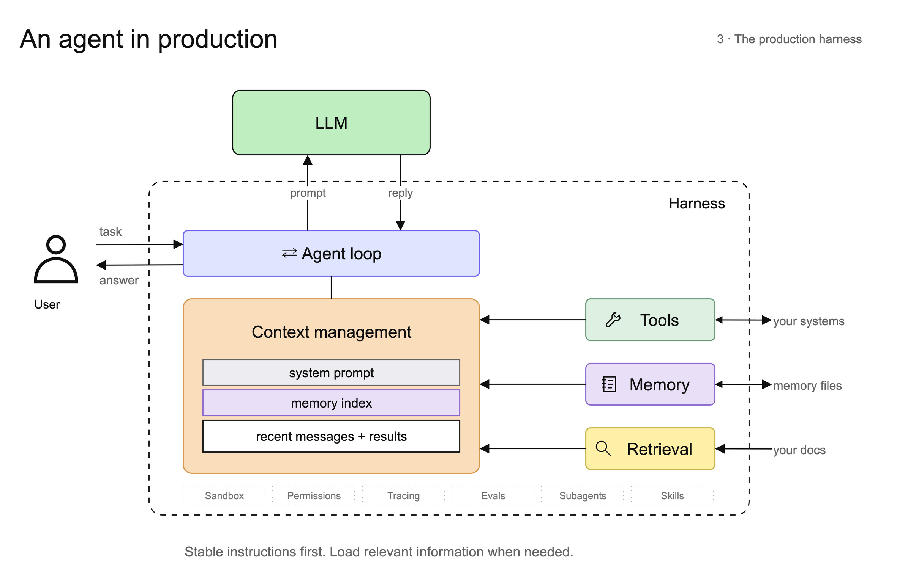

# Pastel Technical Diagrams

Create editable technical diagrams in Sarang's saved pastel presentation style. The preset covers white slide backgrounds, soft category colours, Arial typography, thin outlines, small outline icons and generous spacing.

## Preview



[Open the editable Draw.io example](assets/architecture.drawio).

## Install

Install for Codex across projects:

```sh
npx skills add sarangkharche/skills --skill pastel-technical-diagrams -a codex -g
```

For Claude Code, replace `codex` with `claude-code`. Omit `-g` to install only in the current project.

You need Node.js 22.20 or later and Git. The command fetches the complete skill folder, including its documents, templates and examples. See the [repository installation guide](../README.md#quick-install) for more options.

Alternatively, copy this entire folder manually. From the cloned repository root:

```sh
cp -R ./pastel-technical-diagrams ~/.codex/skills/
```

Start a new chat so the skill can be discovered. Automatic selection remains enabled by default. The Draw.io connector is preferred for interactive diagrams. The native files can also be opened in Draw.io Desktop or imported into [diagrams.net](https://app.diagrams.net/).

## Use

```text
$pastel-technical-diagrams Create a system architecture diagram for a support agent.
```

```text
$pastel-technical-diagrams Compare two context stacks using my pastel reference style.
```

## Animated diagrams

Ask for an animated diagram to get continuously flowing arrows with static pastel blocks and no grey track beneath the moving dashes. Labels, fills, outlines and arrowheads stay still. There is no block highlighting or staged handoff animation.

```text
$pastel-technical-diagrams Create an animated data pipeline with continuously flowing arrows.
```

Keep the editable Draw.io source with the animated preview. Browser previews provide pause and static controls and respect reduced motion preferences. GIF previews loop continuously. Native Draw.io playback and exported animation must be checked separately; a valid XML file does not prove that an animation plays.

See the [animation guidance](references/animation.md) for settings and validation.

## Included documents and examples

1. [Skill instructions](SKILL.md)
2. [Style guide](references/style-guide.md)
3. [Layout patterns](references/patterns.md)
4. [Reference image index](references/reference-index.md)
5. [Machine readable palette and font settings](assets/tokens.json)
6. [Editable architecture example](assets/architecture.drawio)
7. [Editable layer stack starter](assets/layer-stack.drawio)

The layout guide covers architecture, focus slides, stacks, comparisons, registries, tables, charts, trimming, memory documents, folders, wiki networks, tiered layers and recaps.

## Fidelity and limits

The original font and exact original colour tokens are unknown. Arial and Courier New are explicit recreation choices. The palette records the values used for the sample, which Sarang positively reviewed. Four supplied reference screenshots are included. Later screenshots are documented as visual patterns rather than claimed as retained images.

Native shapes, labels and connectors are editable. The architecture icons are embedded Draw.io stencils, so they render without fetching remote images. Icons can move and resize as shapes. Their internal paths can be changed through the stencil definition. No font files or original slide sources are bundled. Reference screenshots remain visual examples; no original rights are asserted.
